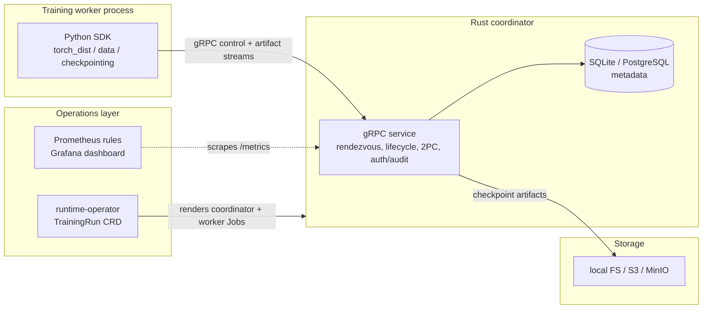

# Architecture Overview

How the production-hardening build of the Distributed Training Runtime is
structured and how the pieces interact. The system splits into a **control
plane** (the Rust coordinator: decisions and metadata), the **Python SDK**
(the API training code uses), and the **operations layer** (Kubernetes
operator, Helm, observability, security).

## Main components

### Rust coordinator (`crates/runtime-coordinator`)
The authoritative control-plane service (tokio + tonic gRPC): run/worker
registration, heartbeat-based failure detection, round-based rendezvous with
stable rank assignment, dataset registration and per-rank shard assignment,
the two-phase checkpoint commit, and durable metadata (SQLite for dev,
PostgreSQL for HA — rehydrated on restart, with advisory-lock leader
election for multi-replica deployments). Requests pass through a layered
authenticator (JWT/OIDC → SPIFFE peer certs → dev metadata headers) with
role-based authorization and structured audit logging (tracing,
JSON-lines/SIEM file, and durable DB sinks); TLS/mTLS via flags. A periodic
reconcile task marks silent workers stale/failed, detects stuck runs, and
enforces checkpoint retention.

### Protocol contract (`crates/runtime-proto`, `proto/runtime.proto`)
The protobuf/gRPC API shared by Rust and Python. Backward compatibility is
enforced by `proto/compat_snapshot.json` + `test_proto_compatibility.py`,
which fail on field removal/rename/renumber/retype.

### Storage abstraction (`crates/runtime-storage`)
Backend-neutral object storage: local filesystem and S3-compatible (aws-sdk,
MinIO-tested) with multipart upload and abort-on-failure, retry with
transient/permanent error classification, full-jitter backoff, and SSE-S3 /
SSE-KMS.

### Checkpoint machinery (`crates/runtime-checkpoint`)
The checkpoint domain model (state machine, artifact records with SHA-256
integrity, JSON manifests, retention policies) plus a `CheckpointStore`
implementing the manifest/commit protocol directly over object storage,
validated against real MinIO.

### Kubernetes operator (`crates/runtime-operator`)
A kube-rs controller for the `TrainingRun` CRD: reconciles a managed
coordinator Deployment/Service and an Indexed worker Job (server-side apply,
owner references, status projection), with pluggable scheduler backends —
plain Kubernetes, Volcano gang scheduling (PodGroup), and Kueue queueing.
Deployable via the raw manifests in `k8s/operator/` or the Helm chart in
`deploy/helm/dtruntime/`.

### Python SDK (`python/dtruntime`)
The user-facing API, torch-free at import:
- `client` — gRPC client wrapper (TLS, auth headers, idempotency keys).
- `torch_dist` / `strategies` / `rendezvous` — coordinator-backed
  `torch.distributed` setup, elastic recovery (`run_elastic`),
  DDP/FSDP/DeepSpeed wrappers.
- `checkpointing` — PyTorch DCP save/restore with two-phase commit through
  the coordinator, corruption detection with fallback, and async save.
- `data` — `DistributedShardDataset` (IterableDataset) with coordinator
  shard assignment, LRU disk cache, prefetching, deterministic shuffle, and
  content-addressed dataset versioning.
- `launch` — torchrun-style multi-worker supervisor.
- `admin` — the `dtruntime-admin` CLI (inspect/pause/resume/retry/drain
  runs, verify checkpoints, doctor).

### Load generator (`crates/runtime-bench`)
Protocol-level benchmark harness: concurrent logical workers over real gRPC
(per-worker tasks, pooled HTTP/2 channels, bounded in-flight RPCs), latency
percentiles per RPC class, failure injection, plus storage and data-plane
benchmarks. See [benchmarks.md](benchmarks.md).

## Component diagram

## Core flows

**Control plane:** `RegisterRun` → `RegisterWorker` (rendezvous assigns
stable ranks) → `Heartbeat` loop (failure detection; responses carry run
state + rendezvous round) → `RegisterDataset` / `GetShardAssignment` /
`ReportShardProgress` → checkpoint 2PC (`BeginCheckpoint` →
`ReportCheckpointArtifact` → `CommitCheckpoint`, committed only when every
expected worker's vote is in) → `GetLatestCheckpoint` for restore.

**Elastic recovery:** a dead worker misses heartbeats → reconciliation marks
it failed → the rendezvous round is invalidated → survivors (and any
replacement) observe the new round, re-form the process group through
`run_elastic`, restore from the latest committed checkpoint, and continue.

**Checkpointing:** DCP writes sharded artifacts; workers stream them to the
coordinator, which persists them under `--storage-root` (optionally
mirroring to S3) and serves restores; corrupt artifacts are detected by
checksum and fall back to the previous committed checkpoint.

**Run lifecycle:** durable states (pending / running / recovering /
completed / failed / cancelled) survive coordinator restarts; admin
operations (cancel/pause/resume/retry/drain) and stuck-run detection drive
transitions. See [run-lifecycle.md](run-lifecycle.md).

## Current boundaries

- Validated locally and on kind clusters (real cross-pod gloo DDP through
  the operator); not yet run on a managed-cloud GPU cluster at scale — see
  [status-and-limitations.md](status-and-limitations.md) for the
  validated-vs-documented matrix.
- Benchmark numbers are single-machine loopback measurements
  ([benchmarks.md](benchmarks.md)).
- S3 object deletion for checkpoint GC is delegated to bucket lifecycle
  rules; the coordinator garbage-collects metadata rows and local artifacts.
