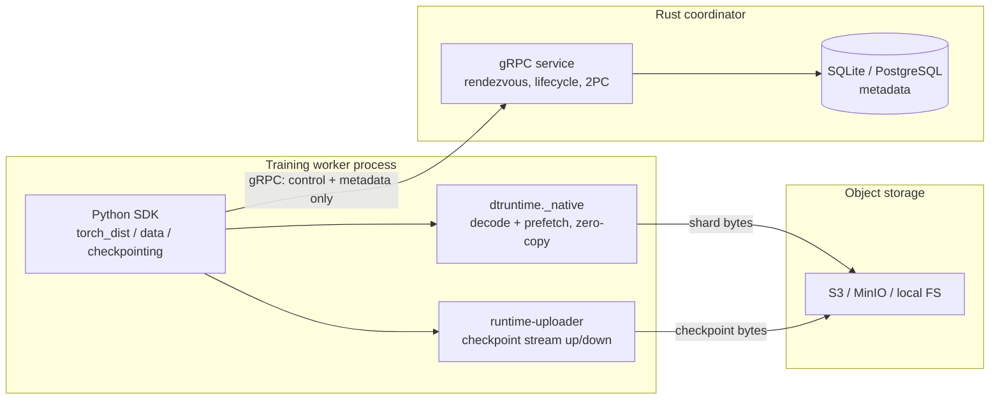
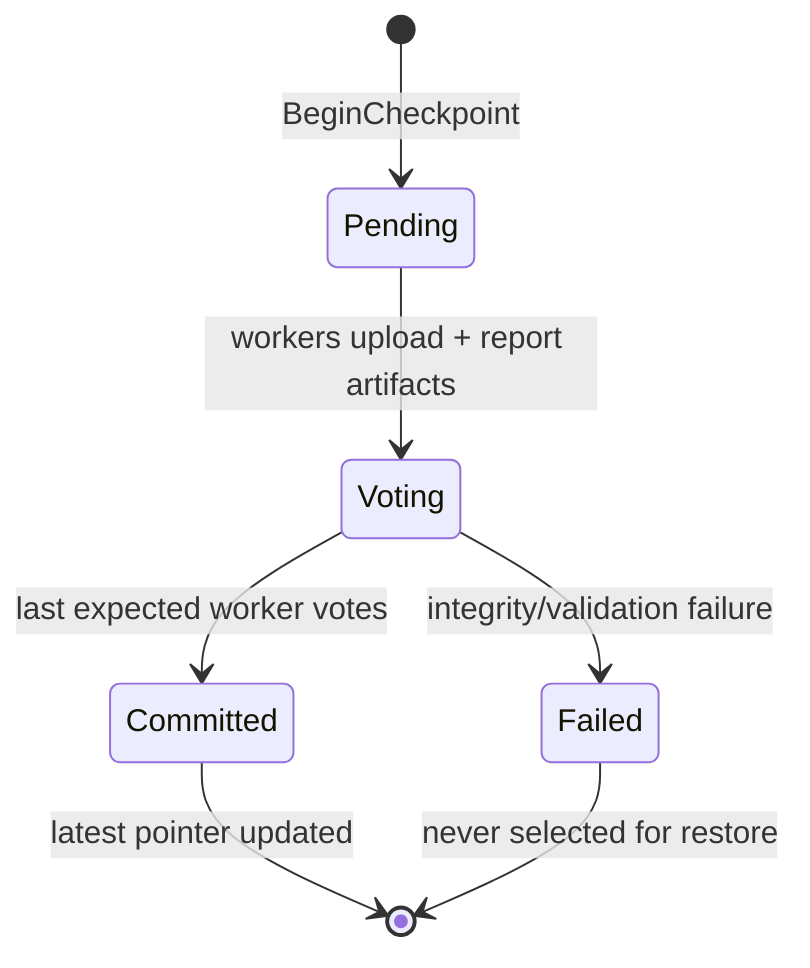

# Architecture Overview

How the Distributed Training Runtime is structured and how the pieces
interact. The system is deliberately split into a **control plane** (the Rust
coordinator: decisions and metadata) and a **data plane** (Rust I/O paths on
the workers: shard and checkpoint bytes). On the S3 path, no artifact byte
ever crosses the coordinator.

## Main components

### Rust coordinator (`crates/runtime-coordinator`)
The authoritative control-plane service (tokio + tonic gRPC): run/worker
registration, heartbeat-based failure detection, round-based rendezvous with
stable rank assignment, dataset registration and per-rank shard assignment,
the two-phase checkpoint commit, and durable metadata (SQLite for dev,
PostgreSQL for HA — rehydrated on restart). A periodic reconcile task marks
silent workers stale/failed, detects stuck runs, and enforces checkpoint
retention. Requests pass through a layered authenticator (JWT/OIDC → SPIFFE
peer certs → dev metadata headers) with role-based authorization and
structured audit logging; TLS/mTLS is available via coordinator flags.

### Protocol contract (`crates/runtime-proto`, `proto/runtime.proto`)
The protobuf/gRPC API shared by Rust and Python. Backward compatibility is
enforced by `proto/compat_snapshot.json` + `test_proto_compatibility.py`,
which fail on field removal/rename/renumber/retype.

### Storage abstraction (`crates/runtime-storage`)
Backend-neutral object storage: local filesystem and S3-compatible (aws-sdk,
MinIO-tested). The S3 backend does streaming uploads from file
(`put_file_async`), streaming downloads to file (`get_to_file_async`,
written to `.part` + renamed so crashes never leave truncated artifacts),
multipart upload with abort-on-failure, retry with transient/permanent error
classification, and SSE.

### Checkpoint machinery (`crates/runtime-checkpoint`, `crates/runtime-uploader`)
`runtime-checkpoint` owns the checkpoint domain model (state machine,
manifests, integrity checks, retention policies). `runtime-uploader` is the
worker-side data mover: a small binary the Python SDK invokes to stream one
artifact worker → S3 (or back with `--download`), keeping the byte-moving
loop in Rust while the training process stays unblocked.

### Data-plane accelerator (`crates/dtruntime-native`)
A PyO3 extension module (`dtruntime._native`, CPython ≥ 3.11) for the
data-loading hot path: whole-shard DTRS decode with the GIL released,
zero-copy tensor handoff via the buffer protocol, off-GIL fetch (s3://,
file://) with SHA-256 verification, and `ShardStream` — an ordered
prefetching iterator that fetches/verifies/decodes shards on Rust threads
while Python consumes. Optional: built by `scripts/build_native.py`; the SDK
falls back to pure Python without it (`DTRUNTIME_NATIVE=0` forces that).

### Python SDK (`python/dtruntime`)
The user-facing API, torch-free at import:
- `client` — gRPC client wrapper (TLS, auth headers, idempotency keys).
- `torch_dist` / `strategies` / `rendezvous` — coordinator-backed
  `torch.distributed` setup, elastic recovery (`run_elastic`), DDP/FSDP/
  DeepSpeed wrappers.
- `checkpointing` — PyTorch DCP save/restore with 2PC through the
  coordinator (the portable local mode).
- `async_checkpoint` — the staged worker-direct S3 pipeline (snapshot →
  local staging → Rust upload → 2PC vote; restore prefers local staging,
  else streams back from S3 with manifest checksum verification).
- `data` — `DistributedShardDataset` (IterableDataset) with coordinator
  shard assignment, LRU disk cache, prefetching, deterministic shuffle, and
  the native fast path for DTRS shards.
- `launch` — torchrun-style multi-worker supervisor.
- `admin` — `dtruntime-admin` CLI (inspect/pause/resume/retry/drain runs,
  verify checkpoints, doctor).

### Load generator (`crates/runtime-bench`)
Protocol-level benchmark harness: thousands of concurrent logical workers
over real gRPC (per-worker tasks, pooled HTTP/2 channels, bounded in-flight
RPCs), latency percentiles per RPC class, failure injection. Used for the
measured baseline in [benchmarks/control-plane-scale.md](benchmarks/control-plane-scale.md).

## Component diagram

## Control-plane flow

1. `RegisterRun` → run_id (idempotent)
2. `RegisterWorker` per worker → rank via rendezvous
3. `Heartbeat` loop (failure detection; response carries run state +
   rendezvous round so workers observe membership changes and cancellation
   without extra RPCs)
4. `RegisterDataset` + `GetShardAssignment` (static rank-striped, optionally
   cache-aware ordering) + `ReportShardProgress`
5. `BeginCheckpoint` → `ReportCheckpointArtifact` (metadata + checksum) →
   `CommitCheckpoint` (per-worker vote; global commit when every expected
   worker has voted)
6. `GetLatestCheckpoint` for restore

## Elastic recovery flow

Worker death → heartbeat deadline missed → reconcile marks it failed → the
rendezvous round is invalidated → survivors (and any replacement) observe
the new round via heartbeats, re-form the process group through
`run_elastic`, restore from the latest *committed* checkpoint, and continue.
`demo/run_demo.py` shows the whole loop in ~30 seconds;
`demo/run_benchmark.py` does it mid-ResNet-18 training with measured numbers.

## Checkpoint flow (two modes)

**Local mode (default, zero external deps):** DCP writes artifacts locally;
workers stream them to the coordinator over gRPC; the coordinator persists
them under `--storage-root` and serves restores. Portable, fine for small
clusters.

**Worker-direct S3 mode (`AsyncCheckpointer`):** training blocks only for
the in-memory snapshot; a background pipeline serializes to local staging,
streams the artifact to S3 through `runtime-uploader`, reports
`{uri, size, sha256}` to the coordinator, and casts the 2PC vote. Restore
prefers the local staged copy (checksum-verified) and otherwise streams the
artifact back from S3, failing loudly on any manifest checksum mismatch.
The coordinator handles metadata and votes only.

## Data-loading flow

`DistributedShardDataset` asks the coordinator for this rank's shards →
shards are fetched through the LRU disk cache (S3 or file) → DTRS shards
decode through `_native` when built (one GIL-released pass, zero-copy
tensors) or pure Python otherwise → records stream to the training loop with
bounded-queue backpressure. Progress is reported back so a restarted worker
resumes mid-shard. Measured A/B numbers:
[benchmarks/data-plane-throughput.md](benchmarks/data-plane-throughput.md).

## Current boundaries

- Single-coordinator control plane (PostgreSQL + advisory-lock HA exists;
  full multi-replica failover coverage lives on `production-hardening`).
- Scale numbers are single-machine/loopback protocol-level measurements —
  see the benchmark docs for exact caveats.
- Not yet validated on a multi-node GPU cluster (same rendezvous/NCCL path,
  unproven claim — stated in the README too).
- Kubernetes/Helm/observability/security hardening live on the
  [`production-hardening`](PATH-TO-PRODUCTION.md) branch, not here.
