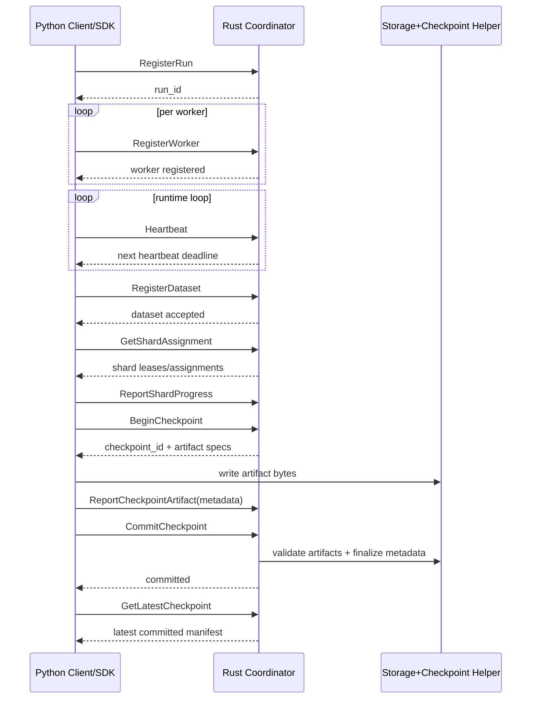
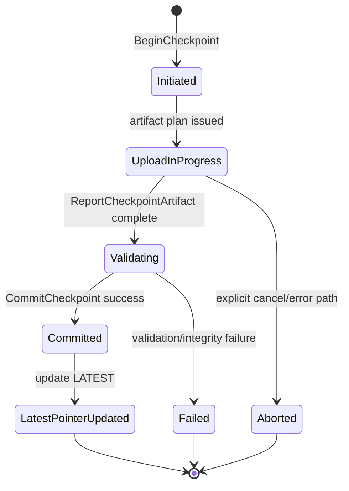

# Architecture Overview

This document describes how the Distributed Training Runtime is structured **today** and how the main components interact. It is intentionally honest about current MVP limits.

For the current project boundary list and validation posture, see [Status and limitations](status-and-limitations.md).

## High-level system overview

Implemented today:
- A Rust coordinator exposes a gRPC control plane.
- A Python SDK and examples call that control plane.
- Storage backends persist checkpoint artifacts/metadata.
- Dataset registration and shard assignment flows are available for local/runtime simulations.
- Optional mTLS via coordinator TLS flags and cert-manager PKI in local-secure Kubernetes path.
- Role-based authorization via metadata-based identity model.
- Structured audit logging via `DbAuditSink`.
- PostgreSQL HA via advisory lock for multi-replica coordinator deployments.
- Local Kubernetes manifests in `k8s/local/` and secure manifests in `k8s/local-secure/`.

Simulated today:
- The PyTorch distributed-style flow is a **single-process simulation** with logical workers and FedAvg-style aggregation.

Not implemented yet (future work):
- Production scheduler integration.
- Real `torch.distributed` execution.
- Dashboard/admin UI.
- Production HA with full failover test coverage.

## Main components

### Rust coordinator (`runtime-coordinator`)
Authoritative control-plane service for run registration, worker lifecycle, heartbeat handling, dataset registration, shard assignment/lease flows, and checkpoint lifecycle RPCs.

### Protocol contract (`runtime-proto`)
Shared protobuf/gRPC API definitions used by Rust and Python components (`proto/runtime.proto`). This is the compatibility boundary for control-plane behavior.

### Client layers (`runtime-client` and Python SDK)
- Rust `runtime-client` supports client-side integration in Rust contexts.
- Python SDK (`python/dtruntime/client.py`) provides user-facing control-plane operations for examples and integration tests.

### Storage abstraction (`runtime-storage`)
Backend-neutral storage interface with local filesystem and optional S3-compatible implementations used by checkpoint/data helpers.

### Checkpoint runtime (`runtime-checkpoint`)
Checkpoint metadata/state helpers and commit-path helpers, including artifact reporting assumptions and latest-pointer semantics.

### Dataset runtime (`runtime-dataset`)
Dataset registration/shard metadata + shard assignment helper logic used by coordinator and simulations.

### Benchmark harness (`runtime-bench`)
Local benchmark and scaling-smoke harness covering control-plane RPC patterns and storage-adjacent benchmark workflows.

### PyTorch examples (`python/examples`)
- `pytorch_train.py`: single-worker local example with checkpoint save/restore.
- `pytorch_simulated_distributed.py`: deterministic, single-process simulated distributed-style training (logical workers + shard mapping + FedAvg-style aggregation).

## Component diagram

```mermaid
flowchart LR
    subgraph PythonSide[Python Side]
      SDK[Python SDK
(dtruntime client)]
      EX[Examples
local_demo / pytorch_*]
    end

    subgraph RustSide[Rust Runtime]
      COORD[Coordinator gRPC service
(runtime-coordinator)]
      DATASET[Dataset/Sharding
(runtime-dataset)]
      CKPT[Checkpoint runtime
(runtime-checkpoint)]
      META[Coordinator state + metadata
(run/worker/checkpoint state)]
      PROTO[Protocol contract
(runtime-proto)]
    end

    subgraph Storage[Storage Backends]
      LOCAL[Local filesystem]
      S3[S3-compatible backend]
    end

    BENCH[Benchmark harness
(runtime-bench)]

    EX --> SDK
    SDK -->|gRPC (runtime.v1)| COORD
    BENCH -->|benchmark RPC calls| COORD
    COORD --> PROTO
    COORD --> DATASET
    COORD --> CKPT
    COORD --> META
    CKPT --> LOCAL
    CKPT --> S3
    DATASET --> LOCAL
```

## Core control-plane flow

The runtime control-plane flow implemented today is:
1. `RegisterRun`
2. `RegisterWorker`
3. `Heartbeat` (repeated)
4. `RegisterDataset`
5. `GetShardAssignment` (+ optional renew/progress updates)
6. `ReportShardProgress`
7. `BeginCheckpoint`
8. `ReportCheckpointArtifact`
9. `CommitCheckpoint`
10. `GetLatestCheckpoint` (restore lookup)



## Data/checkpoint flow

Implemented behavior:
- Artifact bytes are written to storage paths under run/checkpoint namespaces.
- Workers/clients report artifact metadata (path, size, checksum metadata) through control-plane RPCs.
- Commit path validates artifact expectations before finalizing committed checkpoint state.
- Coordinator maintains the latest committed checkpoint pointer for restore lookup.
- Cleanup policies/utilities exist for checkpoint lifecycle maintenance.



## ML integration view (implemented vs simulated)

```mermaid
flowchart TD
    SYN[Synthetic dataset generation]
    SH[Deterministic shard split]
    W1[Logical worker 0
local training step]
    W2[Logical worker 1
local training step]
    AGG[FedAvg-style aggregation
(single process)]
    CK[Checkpoint save/restore]

    SYN --> SH
    SH --> W1
    SH --> W2
    W1 --> AGG
    W2 --> AGG
    AGG --> CK
    CK --> AGG
```

Notes:
- Implemented: deterministic synthetic data, shard assignment logic, worker-local training loops, checkpoint save/restore.
- Simulated: multi-worker behavior in one process, FedAvg-style aggregation loop.
- Not implemented: real multi-process/multi-node `torch.distributed` backend.

## Benchmark and observability view

Implemented today:
- In-process observability foundation: structured logs + runtime metrics counters/gauges.
- `runtime-bench` benchmark harness for local control-plane and scaling smoke tests.
- Worker RPC benchmark and scaling-workers benchmark variants (including simulated large logical worker counts).
- Prometheus/Grafana stack in `observability/` directory.

Not implemented yet:
- Full distributed multi-node profiling.

## Current boundaries

This architecture currently targets local/MVP development workflows:
- Local/MVP coordinator behavior is the primary scope.
- PyTorch distributed-style example is simulated, not true distributed runtime execution.
- No production scheduler integration.
- No real `torch.distributed` integration yet.

## Security architecture companion docs

For the security target model and trust boundaries, see:
- [Security architecture](security-architecture.md)
- [Threat model](threat-model.md)
- [Production readiness](production-readiness.md)
